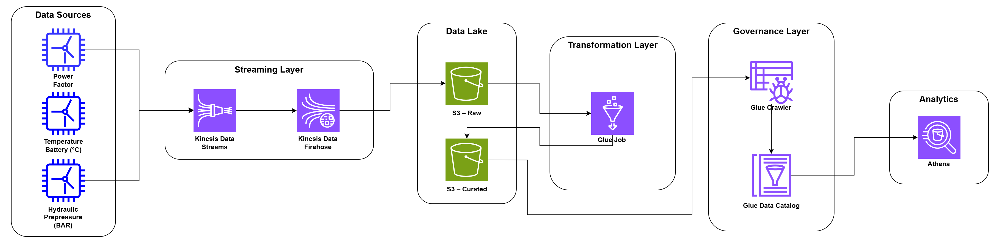

# Documentação do Projeto

Este projeto demonstra e pratica uma arquitetura de dados orientada à nuvem, aplicando boas práticas de cloud e conceitos de processamento batch e streaming.

## Sumário

- [Contexto dos Dados](#contexto-dos-dados)
- [Contexto do Negócio](#contexto-do-negócio)
- [Estrutura do Projeto](#estrutura-do-projeto)
- [Arquitetura do Pipeline](#arquitetura-do-pipeline)
- [Armazenamento](#armazenamento)
- [Ingestão](#ingestão)
- [Transformação](#transformação)
- [Disponibilização](#disponibilização)
- [Stack Tecnológica](#stack-tecnológica)
- [Decisões Técnicas](#decisões-técnicas)

---

## Contexto dos Dados

O pipeline coleta dados simulados de três sensores de uma turbina eólica: pressão hidráulica, temperatura da bateria e fator de potência. Todos os eventos seguem o mesmo schema:

| Campo             | Descrição                                                                 |
|-------------------|---------------------------------------------------------------------------|
| `event_id`        | Hash SHA-256 determinístico do evento                                     |
| `batch_id`        | Lote em que o evento foi gerado                                           |
| `sensor_id`       | Identificador do sensor (ex.: `sensor-hydraulic-01`)                      |
| `type`            | Tipo do sensor (`hydraulic-pressure`, `temperature-battery`, `power-factor`) |
| `value`           | Valor lido pelo sensor (`null` quando há perda de leitura)                |
| `event_timestamp` | Timestamp UTC (ISO 8601) de quando o evento foi gerado                    |

### Faixas de operação

| Sensor                      | Normal   | Atenção (outlier leve) | Crítico      |
|-----------------------------|----------|------------------------|--------------|
| Pressão hidráulica (BAR)    | 150-180  | 180-200 ou 130-150     | >200 ou <130 |
| Temperatura da bateria (°C) | 20-35    | 35-45                  | >45 ou <10   |
| Fator de potência           | 0.92-1.0 | 0.85-0.92              | <0.85        |

> Atualmente o gerador produz apenas a faixa de **atenção superior** (180-200, 35-45 e 0.85-0.92). Valores críticos e a faixa de atenção inferior da pressão não são gerados.

### Origem dos valores

A simulação separa dois fenômenos distintos:

| Função          | O que simula                  | Exemplo                        |
|-----------------|-------------------------------|--------------------------------|
| `maybe_outlier` | Evento físico real na turbina | Pressão subindo por sobrecarga |
| `apply_error`   | Falha no sensor ou na comunicação | Leitura travada, deriva, ruído |

- `maybe_outlier`: a cada leitura, há 5% de chance de o valor vir da faixa de atenção em vez da faixa normal.
- `apply_error`: aplica falhas baseadas nos padrões SCADA ([fonte: ScienceDirect](https://www.sciencedirect.com/science/article/abs/pii/S2352467723001340)). A literatura documenta **bias**, **drift**, **frozen** (travado em um valor), **intermittent** e **precision degradation**. Foram implementados:

| Erro      | O que simula                                  | Exemplo real                            |
|-----------|-----------------------------------------------|-----------------------------------------|
| `frozen`  | Sensor trava em um valor e para de atualizar  | Cabo danificado, falha no ADC           |
| `drift`   | Leituras se afastam gradualmente do valor real, sem causa física, e depois retornam | Desgaste, descalibração |
| `bias`    | Desvio de ±3% sobre a leitura                 | Sensor mal instalado, calibração errada |
| `noise`   | Oscilação aleatória em torno do valor (σ = 2%) | Interferência elétrica, vibração       |
| `missing` | Leitura ausente (`value = null`)              | Falha de comunicação, sensor desconectado |

### Pesos dos erros por sensor

Quando um erro é disparado, o tipo é sorteado com os pesos abaixo. Os pesos são independentes por sensor.

| Erro      | Pressão hidráulica | Temperatura da bateria | Fator de potência |
|-----------|--------------------|------------------------|-------------------|
| `frozen`  | 30%                | 35%                    | —                 |
| `drift`   | 10%                | 30%                    | 35%               |
| `bias`    | 20%                | —                      | 30%               |
| `noise`   | —                  | 25%                    | 25%               |
| `missing` | 40%                | 10%                    | 10%               |

### Frequência de erros

A probabilidade de erro por leitura começa em 10% e cresce linearmente até o teto de 30% (ver [Decisões Técnicas](#decisões-técnicas)). Enquanto um episódio de `frozen` ou `drift` está ativo, ele continua independentemente desse sorteio.

---

## Contexto do Negócio

- Dispositivos IoT geram dados quase em tempo real, e o monitoramento nesse cenário é essencial para identificar rapidamente falhas nas turbinas.
- Os dados precisam estar disponíveis para analistas e cientistas de dados, permitindo analisar a qualidade dos sensores e treinar modelos que prevejam falhas antes que ocorram.

---

## Estrutura do Projeto

```text
.
├── docs/                          # Documentação e diagramas
├── sql/
│   └── analytics/
│       └── registro_intervalo_datas.sql   # Consultas do Athena
├── src/
│   ├── ingestion/
│   │   └── stream_writer.py       # Envio de registros ao Kinesis
│   ├── processing/
│   │   └── transform_job.py       # Script do Glue Job
│   ├── producers/
│   │   ├── event.py               # Montagem do evento e event_id
│   │   ├── hydraulic_pressure.py
│   │   ├── power_factor.py
│   │   └── temperature_battery.py
│   ├── simulation/
│   │   ├── error_model.py         # Modelo de erros (frozen, drift, bias...)
│   │   └── value_generator.py     # Geração de valores por sensor
│   ├── utils/
│   │   ├── decorators.py          # Log de envio ao Kinesis
│   │   └── logger.py
│   ├── cli.py                     # Argumentos de execução
│   └── pipeline.py                # Orquestrador do produtor
├── .env.example
├── .gitignore
├── .python-version
├── pyproject.toml
├── README.md
└── uv.lock
```

---

## Arquitetura do Pipeline



O pipeline segue uma arquitetura em camadas: streaming, armazenamento, transformação, governança e disponibilização.

```text
Python → Kinesis Data Streams → Kinesis Firehose → S3 (raw) → Glue Job → S3 (curated) → Glue Crawler → Glue Data Catalog → Athena
```

---

## Armazenamento

O Amazon S3 é o Data Lake do projeto e organiza os dados em duas camadas:

- **Raw:** eventos em JSON, exatamente como entregues pelo Firehose, sem alterações.
- **Curated:** dados tratados em Parquet (compressão Snappy), particionados por `type`.

Manter a camada raw intacta permite reprocessar os dados sempre que a transformação mudar.

---

## Ingestão

Três simuladores (um por sensor) geram, a cada lote, um evento JSON cada. O intervalo entre lotes e a duração da rampa de erros são definidos na execução:

| Argumento            | Descrição                                  | Padrão |
|----------------------|--------------------------------------------|--------|
| `-s`, `--sleep`      | Intervalo entre lotes, em segundos         | 2      |
| `-r`, `--ramp-duration` | Duração da rampa de erros, em segundos  | 300    |

O nome do stream é lido da variável de ambiente `STREAM_NAME`.

Os eventos são enviados ao **Kinesis Data Streams**, usando `sensor_id` como partition key, o que preserva a ordenação por sensor. O client do boto3 usa retry em modo `standard` (3 tentativas) e timeouts de 5s. Cada envio é logado com tempo de resposta, shard e `batch_id`. Em seguida, o **Kinesis Firehose** entrega os registros na camada raw do S3.

---

## Transformação

Um **AWS Glue Job** lê a tabela raw do Glue Data Catalog, avalia regras de Data Quality e grava o resultado na camada curated em Parquet, particionado por `type`. Depois, um **Glue Crawler** infere o schema dos dados curados e atualiza o Data Catalog.

> **Pendente:** deduplicação por `event_id` dentro do job (ver [Decisões Técnicas](#decisões-técnicas)).

---

## Disponibilização

O **Amazon Athena** consulta as tabelas catalogadas na camada curated usando SQL, sem necessidade de provisionar servidores. Como os dados estão em Parquet e particionados, as consultas leem menos dados e custam menos. As consultas analíticas ficam em `sql/analytics/` e são usadas para detectar os comportamentos anômalos descritos em [Contexto dos Dados](#contexto-dos-dados), como `frozen` e `drift`, com funções de janela.

---

## Stack Tecnológica

As tecnologias usadas em cada camada do pipeline estão listadas na seção [Stack Tecnológica do README](../README.md#stack-tecnológica). Esta documentação não repete a tabela para evitar duas versões divergentes.

---

## Decisões Técnicas

### Idempotência: SHA-256 em vez de UUID

O `event_id` é um hash SHA-256 calculado sobre `sensor_id`, `batch_id`, `value` e `timestamp`. A escolha evita duplicação: como o envio faz retries, o mesmo payload sempre gera o mesmo ID, o que permite deduplicar no Glue. O SHA-256 também equilibra tamanho, desempenho e risco de colisão, praticamente nulo. UUIDs aleatórios não permitiriam essa deduplicação.

### Teto de 30% de erros

A probabilidade de erro por leitura nunca passa de 30%. Acima disso, a proporção anomalia/normal invalidaria a premissa de detecção, que depende de uma linha de base normal predominante.

### Rampa de degradação

A probabilidade de erro cresce de forma linear ao longo do tempo, simulando um sensor que opera continuamente e se degrada:

```python
DURACAO_RAMPA_SEGUNDOS = 15 * 60                  # 900s
TAXA = 0.2 / DURACAO_RAMPA_SEGUNDOS               # ≈ 0.000222/s

error_rate = min(0.1 + TAXA * segundos_decorridos, 0.3)
```

- **Por que linear:** um salto instantâneo de 10% para 30% criaria uma assinatura detectável na frequência de eventos, que poderia confundir a detecção de drift.
- **Trade-off da duração:** quanto mais curta a rampa, mais ela se aproxima do degrau; quanto mais longa, menos tempo a run passa no teto. Com rampa de 10-15 min, sobram 45-50 min no teto em uma run de 1h.
- **Execução:** o padrão da CLI é 300s. Para a rampa de 15 min, execute com `-r 900`.

### Episódios de `frozen`

Duração de 3 a 6 leituras idênticas. Esse intervalo gera mais episódios distintos do que, por exemplo, 5 a 10, o que dá às queries de detecção mais casos separados para validar, em vez de poucos eventos longos. O mínimo de 3 leituras fica 1 acima do limiar de 2 usado na query com `LAG`.

### Episódios de `drift`

- **Início em 4%:** se o drift começasse em 3%, a primeira leitura teria a mesma magnitude do teto do `bias` (±3%), e a query de detecção não conseguiria distinguir os dois. Com 4%, o drift fica acima do teto do bias desde a primeira leitura.
- **Crescimento:** +1% por leitura durante 6 a 10 leituras, com pico entre 9% (4% + 5×1%) e 13% (4% + 9×1%).
- **Retorno:** após o pico, o desvio desce 1% por leitura até voltar a 4%, e então o episódio termina. O episódio completo tem de 11 a 19 leituras.

### Partition key do Kinesis

A partition key é o `sensor_id`. Usar `event_id` equivaleria a uma chave aleatória e perderia a ordenação por sensor. Com 1 turbina e 1 shard, o comportamento e o custo não mudam, mas a escolha é uma boa prática.

### Retry no envio

O retry é o nativo do boto3 (modo `standard`, 3 tentativas), configurado no client. O decorator `log_kinesis_end` registra o tempo total e a falha final, e `send_batch` conta apenas os sucessos. A fila de reenvio para falhas definitivas fica para ser analisada junto com a idempotência.